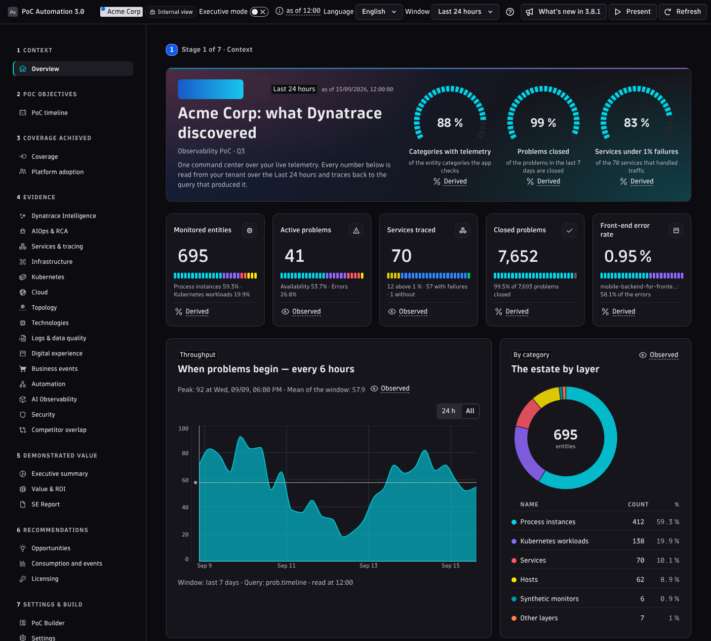

<div align="center">

# PoC Automation 3.0

### All in One — run a Dynatrace proof of concept end to end, from one app


</div>

**PoC Automation 3.0** is a Dynatrace AppEngine app that Sales Engineers and partners use to run a proof of
concept from the first day to the closing deck. It reads the customer's own Dynatrace environment, tells the
story of the PoC in **nine stages** — from what exists, to what the platform discovered, to the value it
demonstrated and the next steps — builds the PoC's dashboards, notebooks, SLOs, workflows, monitors and
OpenPipeline configuration on the tenant with one click each, and exports the **SE Report**, the **Coverage PDF**
and the **Tech Wrapup deck**. Every number on screen and on paper comes from a catalogued DQL query, with its
evidence class, the exact query and the time it was read — nothing estimated, nothing invented.

<p align="center">
  
</p>
<p align="center"><em>The Overview — stage 1 of 9 (fictitious company, synthetic data).</em></p>

> **What's new in 3.7.9** — the **Autonomous Value Cycle** on the Coverage page (the value events the PoC demonstrated
> on each link — Context, Cause, Impact, Action, Prevention —, the next wave of each link and the autonomy target agreed
> with the customer), a menu in **nine stages**, the **30-60-90 action plan** as a tab of Opportunities, and the
> **Dynatrace brand kit included** for Dynatrace collaborators and official partners (see the
> [rights notice](#dynatrace-brand--rights-notice)).

---

## Contents

- [What's inside](#whats-inside)
- [How it works](#how-it-works)
- [Getting started](#getting-started)
- [Permissions](#permissions)
- [Quality](#quality)
- [Project structure](#project-structure)
- [Documentation](#documentation)
- [Português (Brasil)](#português-brasil)
- [Disclaimer](#disclaimer)
- [License](#license)

---

## What's inside

### The story in nine stages

The side menu follows the arc of a PoC. A pager at the foot of each page leads to the next page of the story and
respects what the current audience may see.

| # | Stage | Pages |
| --- | --- | --- |
| 1 | **Context** | Overview — the environment and the PoC on one screen: from the user to the cloud, change since Day 0, problem arrivals |
| 2 | **PoC objectives** | PoC timeline — the days of the PoC, daily signals and the success criteria |
| 3 | **Coverage achieved** | Coverage (index, the **Autonomous Value Cycle**, findings and an agreed action plan) · Platform adoption |
| 4 | **Evidence** | Dynatrace Intelligence · AIOps & RCA (propagation, investigation, affected entities) · Services & tracing · Infrastructure · Kubernetes · Cloud · Topology · Technologies · Logs & data quality · Digital experience · Business events · Automation · **AI Observability** (GenAI tokens, models, services and calls) · Security · Competitor overlap |
| 5 | **Impact** | Executive summary (Day 0 against today, MTTR) · Consumption and events |
| 6 | **Demonstrated value** | Value & ROI · SE Report (report, first-day message, Tech Wrapup deck, real proofs) |
| 7 | **Recommendations** | Opportunities, with the **30-60-90 action plan** |
| 8 | **Next steps** | Licensing (for the SE and partners) |
| 9 | **Settings & Build** | **PoC Builder** · Settings |

The **Autonomous Value Cycle** tells what the PoC already delivered: around a Foundation, five links that feed each
other — Context, Cause, Impact, Action and Prevention — each count the value events the PoC demonstrated, from what
the app reads on the environment, with the next wave of each link; an autonomy ladder (observe, explain, prioritise,
propose, act) shows the rungs demonstrated and the target agreed with the customer.

A setup guide walks the SE through seven readiness steps (customer, logo, scope, dates, success criteria, a
dashboard, the team's working figures). While the PoC is being prepared the menu stays hidden; the whole app opens at
five of the seven steps.

### The PoC Builder — build on the tenant, one click at a time

Everything the Builder creates is listed in a **Register** with its link, and the **end-of-PoC clean-up** removes
what the SE ticks. Every text it writes on the tenant follows the language of the screen (English or Brazilian
Portuguese).

| Tab | What it builds |
| --- | --- |
| **Smart Dashboards · 8** | Environment health and SLOs · Operations and reliability · Infrastructure and cloud · Digital experience and business · Runtime security · Logs and data quality · Kubernetes and containers · Databases and dependencies — each with section banners and the customer's logo in the corner |
| **Notebook and launchpad** | An investigation notebook on the golden signals (it opens with its charts already drawn) and a PoC launchpad |
| **SLOs** | Availability and performance SLOs of the busiest services, and fleet SLOs (host CPU, host memory, Kubernetes workloads without restarts) |
| **Workflows** | A problem-triage workflow and a weekly PoC summary, handed to the Workflows app ready to save. Both run the app's own workflow actions, add a Dynatrace Assist reading and send a formal Markdown e-mail; the weekly run also writes a notebook with the week's charts |
| **Synthetic** | **Browser monitors** (a real browser: load times, Core Web Vitals, a screenshot on failure) and **HTTP monitors** of the customer's addresses |
| **OpenPipeline** | A logs pipeline that gives a level to records written without one, the route that sends the sources the SE ticks to it, and a check of what went through |
| **Anomaly detection** | Detectors on the golden signals (failure rate, response time p90, traffic drop), opened in the **Anomaly Detection app** already filled in, to be saved there |
| **Register** | What the PoC created, with links, and the clean-up |

### Workflow actions

Two actions ship with the app and appear inside Workflows:

| Action | Reads | Returns |
| --- | --- | --- |
| `my.poc.automation:poc-triage` — **PoC Automation · Triage** | The problem, its error and warning logs around the incident, and who calls its root cause | A subject, the problem's sections and the links — ready for an e-mail with a summary callout and a table of facts |
| `my.poc.automation:poc-weekly` — **PoC Automation · Weekly** | This week against the week before: problems, MTTR, the share closed with a root cause, what repeated most, the services failing most | The week's tables with ▲ / ▼ "better" / "worse", links to platform pages, and the week's report notebook |

Both run with the workflow actor's own permissions and read only entries of the app's query catalog.

### Exports

| Export | Format | Content |
| --- | --- | --- |
| **SE Report** | PDF (browser print) | The value report with provenance, plus the first-day message |
| **Coverage** | PDF · JSON · CSV | Every Coverage tab with both logos and "Method and sources"; a machine-readable reading; the action plan |
| **Prerequisites** | PDF | A guide for the customer's teams: connectivity, addresses to allow, six checklists with documentation links |
| **Tech Wrapup** | PPTX + PDF | The closing deck, with pictures of the app's panels and numbered pins explained in a "How to read" legend |
| **Real proofs** | PPTX + PDF | Screenshots of the platform's own screens, read by the app, pinned where the labels were found, masked on export |

Every export has a **profile**: *Customer* (no licensing nor consumption figures) or *SE* (keeps the SE's working
data and marks each page as internal).

### Access levels

| Level | How it is decided | What it can do |
| --- | --- | --- |
| **SE** | The platform's session e-mail belongs to the Dynatrace corporate domain | Everything, including creating on the tenant and managing partner access |
| **Partner** | Enters the PoC password set by the SE (or a master password), for a limited time | Every page and export, commercial data included; creates nothing on the tenant |
| **Customer** | Everyone else | A read-only executive view: Overview, PoC timeline, Executive summary |

**Executive mode** is a presentation switch in the header: before sharing the screen, it hides the technical
pages, Settings, the PoC Builder and every commercial figure. Passwords are kept only as PBKDF2-SHA256 verifiers,
never in clear.

---

## How it works

- **A query catalog with scan guards.** Every read from Grail is one of **128 catalogued DQL queries**
  (`ui/app/queries/`), each with its purpose, required scope, time window, a validation record and scan guards sent
  as request fields (scan limit, record limit, timeout). Queries that need an id are typed templates whose values
  are validated before rendering — an id is never concatenated into DQL. Pages read data only through
  `useCatalogQuery`.
- **Provenance on every number.** A number is a `Fact`: value, unit, evidence class (*observed*, *derived*,
  *partial*, *projection*…), the query that produced it and the read time. A missing value says why — no
  permission, no telemetry, failed — and is never shown as zero. A capped list is shown as "top N" and never summed.
- **App State.** The PoC's shared configuration, the SE's private working figures, partner access and the Coverage
  history live in the platform's App State service. The storage keys keep the historic `pvs.*` prefix, and a PoC
  can be exported and imported as a file.
- **Licensing stays with the SE and the partner.** The Licensing page is hidden in executive mode and never reaches
  a customer export.
- **Nothing created on the tenant without a click.** Every Builder kit writes only after the SE clicks and
  confirms; workflows and anomaly detectors are saved by the SE in their own platform apps.
- **The Dynatrace look.** The pages are built on the Strato Design System, with the platform's own charts wrapped
  in a thin layer (`ui/app/engine/strato/`) that also prints cleanly on paper.

More in [docs/ARCHITECTURE.md](docs/ARCHITECTURE.md).

---

## Getting started

### Prerequisites

- **Node.js 24** (see `.nvmrc`) and npm.
- A **Dynatrace SaaS environment** on the latest platform, and a user allowed to install and run apps
  (`app-engine:apps:install`, `app-engine:apps:run`).
- The Dynatrace App Toolkit (`dt-app`) comes with the dev dependencies; its documentation is at
  <https://developer.dynatrace.com/>.

### Install and run locally

```bash
npm ci
npx dt-app dev --environment-url https://<your-environment-id>.apps.dynatrace.com/
```

The `environmentUrl` in `app.config.json` is a placeholder on purpose: always pass the target environment on the
command line.

### Before you deploy

- **Partner master password.** `ui/app/config/access.ts` ships a *placeholder* verifier (`deadbeef…`), so no master
  password opens the app. Replace it with a PBKDF2-SHA256 verifier of your own (a random 16-byte salt,
  600,000 rounds), or leave it: partners then enter only with the PoC password the SE sets.
- **Contact address.** `ui/app/config/appInfo.ts` carries a placeholder (`se@example.com`) for the footer's
  feedback link.
- **Blocked tenants.** `ui/app/features/wrapup/prints/capture/tenantGuard.ts` holds the SHA-256 of placeholder
  environment ids from which the Real proofs refuse screenshots; put your own there if needed.
- **Dynatrace brand.** The repository includes the Dynatrace brand kit, so the decks and PDFs come out in the
  Dynatrace brand; it is for Dynatrace collaborators and official Dynatrace partners only — read the
  [rights notice](#dynatrace-brand--rights-notice). If you are neither, run `npm run brand:strip` before any use: the
  app then builds every deck on a neutral theme. `npm run brand:status` tells which one is in use.

### Deploy

```bash
npx dt-app deploy --optimize --enable-code-splitting \
  --environment-url https://<your-environment-id>.apps.dynatrace.com/
```

At install time the platform asks you to accept the app's scopes ([Permissions](#permissions)). Deploy each
version once, with a new version number; to roll back, deploy the previous release under a new, higher number.
Step by step in [docs/DEPLOYMENT.md](docs/DEPLOYMENT.md).

---

## Permissions

The manifest (`app.config.json`) declares **25 scopes**, each with a comment. Details in
[docs/PERMISSIONS.md](docs/PERMISSIONS.md).

| Scope | Why |
| --- | --- |
| `storage:entities:read` | Inventory of hosts, services, applications, processes, Kubernetes and synthetic monitors |
| `storage:smartscape:read` | Smartscape on Grail: cloud service families and Kubernetes pods |
| `storage:events:read` | Problems, Kubernetes operational events and synthetic events |
| `storage:system:read` | System events: usage, workflow and query execution, platform adoption, the app's own query usage |
| `storage:buckets:read` | Bucket retention, volume and access |
| `storage:logs:read` | Log volume, levels and quality — always scan-limited, sampled or in a short window |
| `storage:metrics:read` | Host, service, Kubernetes and real-user trends, SLO indicators, GenAI metrics |
| `storage:bizevents:read` | Business observability |
| `storage:security.events:read` | Vulnerabilities and runtime risk |
| `storage:user.sessions:read` | Real user sessions |
| `state:app-states:read` | Read the shared PoC configuration |
| `state:app-states:write` | Save the shared PoC configuration |
| `state:app-states:delete` | "New PoC": delete the shared configuration |
| `state:user-app-states:read` | Read the user's own working figures |
| `state:user-app-states:write` | Save the user's own working figures |
| `state:user-app-states:delete` | "New PoC": delete the user's own figures |
| `document:documents:read` | Read back the documents the app created and the SE's private real-proofs set |
| `document:documents:write` | Create and update the Builder's dashboards, notebook and launchpad, the real-proofs set and the weekly notebook |
| `document:documents:delete` | End-of-PoC clean-up of the documents in the Register |
| `slo:slos:read` | Read an SLO's version before removing it |
| `slo:slos:write` | Create the PoC's SLOs and remove them in the clean-up |
| `environment-api:synthetic:read` | List the public synthetic locations |
| `environment-api:synthetic-monitors:write` | Create and remove the PoC's Browser and HTTP monitors |
| `settings:objects:write` | Create and remove the OpenPipeline pipeline and write the PoC's route in the logs routing |
| `settings:objects:read` | Read the logs routing, so that only the PoC's route is added or removed |

The app declares no `automation:*` scope: workflows are handed to the Workflows app and saved there with the
user's own permissions.

---

## Quality

| Gate | Command | Result for 3.7.9 |
| --- | --- | --- |
| Types (UI and workflow actions) | `npm run typecheck` | clean |
| Lint | `npm run lint` | clean |
| Unit and component tests | `npm test` | **2,079 passed**, 0 skipped, 146 test files |
| Query catalog | `npm run docs:catalog` | 128 queries, regenerated |
| AppEngine analysis | `npm run analyze` | part of `scripts/release-gates.sh` |
| Delivery build | `npm run build -- --optimize --enable-code-splitting` | part of `scripts/release-gates.sh` |

The **visual harness** (`scripts/visual/`) builds the app for production and serves it with mocks of the platform
SDKs and two fixtures (`rich` and `sparse`) — no tenant is read. It walks every route on desktop, tablet and
phone, light and dark, English and Portuguese; checks contrast, keyboard focus, touch-target size, duplicate ids,
the console and the layout fit; renders every export (`--exports`) and runs interaction states (`--states`).
`scripts/release-gates.sh <label>` runs the gates above in one go. See
[scripts/visual/README.md](scripts/visual/README.md).

---

## Project structure

```text
.
├── app.config.json          # AppEngine manifest: id, name, version, 25 scopes, the two workflow actions
├── actions/                 # Workflow actions "Triage" and "Weekly" and their forms
├── ui/
│   ├── main.tsx
│   └── app/
│       ├── App.tsx          # Shell: lazy routes, access gate, header, menu, pager
│       ├── config/          # Navigation, access, PoC context, persistence, assumptions
│       ├── queries/         # The query catalog, parameterised templates, scan metadata
│       ├── hooks/           # useCatalogQuery — the single door to Grail
│       ├── models/          # Pure models: provenance, PoC plan, licensing, RCA…
│       ├── engine/          # Visual engine: panels, figures, evidence, Strato chart layer, print styles
│       ├── features/        # Builder, dashboards, triage, weekly, setup, wrapup, coverage, value cycle…
│       ├── pages/           # One page per route
│       ├── i18n/            # Typed English / Brazilian Portuguese dictionary
│       └── tests/           # Vitest + Testing Library
├── scripts/                 # Release, gates, deploy, query-catalog generator, brand pack, visual harness
└── docs/                    # Architecture, permissions, deployment, query catalog, images
```

---

## Documentation

| Document | Content |
| --- | --- |
| [docs/ARCHITECTURE.md](docs/ARCHITECTURE.md) | How the app is built: stages and routes, access, the query catalog and provenance, persistence, the PoC Builder, the workflow actions, exports, languages |
| [docs/PERMISSIONS.md](docs/PERMISSIONS.md) | The 25 scopes and why each one is needed |
| [docs/DEPLOYMENT.md](docs/DEPLOYMENT.md) | Build, deploy, versioning and rollback with `dt-app` |
| [docs/QUERY-CATALOG.md](docs/QUERY-CATALOG.md) | Every catalogued query with its DQL, guards and validation record (generated) |
| [CHANGELOG.md](CHANGELOG.md) | Release notes |

---

## Português (Brasil)

O **PoC Automation 3.0** é um app do Dynatrace AppEngine para SEs e parceiros conduzirem uma prova de conceito do
primeiro dia ao deck de encerramento — "All in One". Ele lê o próprio ambiente Dynatrace do cliente e conta a
história da PoC em **nove etapas** (Contexto, Objetivos da PoC, Cobertura alcançada — com o **Ciclo de Valor
Autônomo** —, Evidências — com a Observabilidade de IA —, Impacto, Valor demonstrado, Recomendações — com o
**Plano de ação 30-60-90** —, Próximos passos e Configurações & Construção). O **PoC Builder** cria no tenant, com um clique e uma confirmação cada: oito Smart Dashboards, o
notebook de investigação e o launchpad, SLOs, os workflows de triagem e de resumo semanal (com as ações próprias do
app e a leitura do Dynatrace Assist), monitores Browser e HTTP, o pipeline e a rota do OpenPipeline e os detectores
de anomalia (pelo app Anomaly Detection); tudo fica no Registro e sai na limpeza do fim da PoC. O app exporta o
Relatório do SE, o PDF de Cobertura, o guia de pré-requisitos, o deck Tech Wrapup e as Provas reais. Cada número
vem de uma consulta DQL catalogada, com a classe de evidência, a consulta e o momento da leitura; o Licenciamento
fica só com o SE e o parceiro. A interface está em inglês e em português do Brasil.

**Marca Dynatrace — aviso de direitos.** O repositório inclui a marca Dynatrace (nome, logos, a fonte DT Flow e
modelos de apresentação) para que colaboradores da Dynatrace e parceiros oficiais Dynatrace gerem decks e
relatórios na marca. Todos os direitos sobre a marca e esses ativos pertencem exclusivamente à Dynatrace LLC; o uso
é restrito a colaboradores e parceiros oficiais da Dynatrace, conforme as diretrizes de marca da Dynatrace. Qualquer
outra pessoa deve removê-los antes de qualquer uso (`npm run brand:strip` volta o app ao tema neutro).

Para começar: `npm ci`, depois `npx dt-app dev --environment-url https://<id-do-ambiente>.apps.dynatrace.com/`.
Antes de implantar, veja "Before you deploy" acima (senha mestra, endereço de contato e tenants bloqueados são
marcadores de lugar).

---

## Disclaimer

- **Not an official Dynatrace product.** PoC Automation 3.0 is an independent project. It is not developed,
  endorsed or supported by Dynatrace, and Dynatrace Support does not handle it.
- **Provided as is**, without warranty of any kind, express or implied. Review the code, the scopes it requests and
  what it creates before installing it in any environment; you use it at your own risk.
- **Trademarks.** Dynatrace, Grail, Smartscape, OneAgent, Strato and related marks belong to Dynatrace LLC. The
  Dynatrace brand assets in this repository are covered by the rights notice below. Other marks belong to their
  owners.
- **No customer data.** This repository contains no customer data, no tenant ids and no credentials. Validation
  notes in the query catalog refer to an internal lab environment only by that description.
- **Example screens.** The screenshot shows a fictitious company, **ACME Corp**, with synthetic data produced by the
  visual harness.

### Dynatrace brand — rights notice

This repository includes the **Dynatrace brand** — the Dynatrace name, logos and product logomarks, the **DT Flow**
typeface and the presentation templates (`ui/assets/techwrapup-brand-template.pptx`, `ui/assets/Dynatrace_Logo.svg`
and the embedded assets in `ui/app/features/wrapup/` — `brand.ts`, `fonts.ts`, `productLogos.ts` —,
`ui/app/components/spectrum/brandGlyphs.ts` and `ui/app/models/cloudLogos.ts`) — so that **Dynatrace collaborators
and official Dynatrace partners** produce decks and reports in the Dynatrace brand.

- **All rights** to the Dynatrace brand and to those assets belong **exclusively to Dynatrace LLC**. Cloud provider
  logos belong to their owners. Their inclusion here grants no licence of any kind.
- **Their use is restricted** to Dynatrace employees and official Dynatrace partners, under Dynatrace's brand
  guidelines.
- **Anyone else must remove them before any use** of this repository: `npm run brand:strip` replaces the Dynatrace
  assets with empty stubs and turns the app back to a neutral theme (`npm run brand:status` confirms it); the cloud
  provider logomarks are removed by emptying the three entries of `ui/app/models/cloudLogos.ts` (`AWS`, `Azure`,
  `GCP`), after which the deck names the provider without a mark.

## License

Copyright © 2026 Andrey Rafael. **All rights reserved.** This project is not licensed for redistribution or reuse
(`"license": "UNLICENSED"` in `package.json`). Viewing the source does not grant any right to copy, modify or
distribute it.
