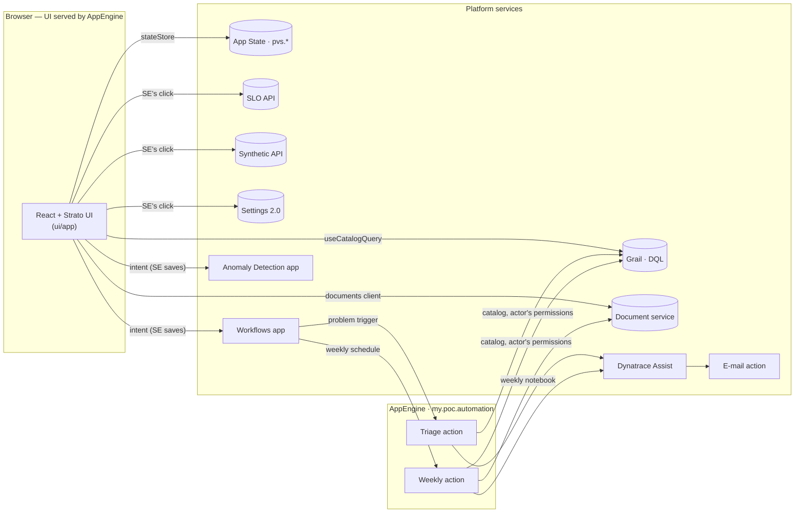
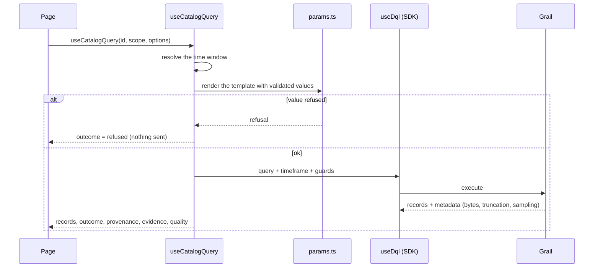
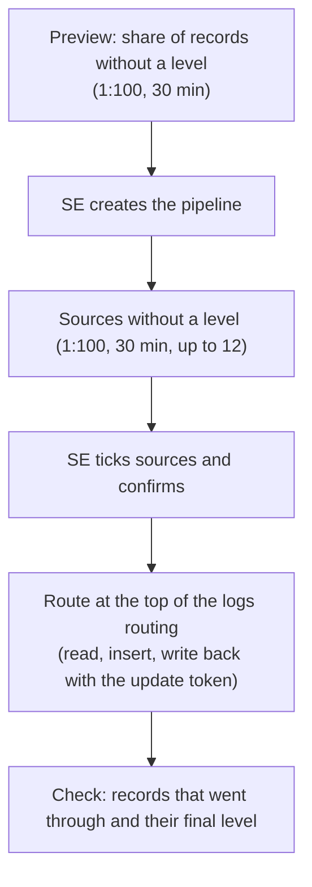

# Architecture

> **App:** PoC Automation 3.0 · **id:** `my.poc.automation` · **platform:** Dynatrace AppEngine · **release:** 3.8.0
>
> The code is the source of truth. This document describes how the app is built and the rules it keeps.

## Contents

1. [Purpose and audience](#1-purpose-and-audience)
2. [Platform pieces and folders](#2-platform-pieces-and-folders)
3. [The nine stages: pages and routes](#3-the-nine-stages-pages-and-routes)
4. [Access and roles](#4-access-and-roles)
5. [Data: the query catalog and provenance](#5-data-the-query-catalog-and-provenance)
6. [Persistence](#6-persistence)
7. [Visual engine, print and the visual harness](#7-visual-engine-print-and-the-visual-harness)
8. [The PoC Builder](#8-the-poc-builder)
9. [Workflow actions](#9-workflow-actions)
10. [Exports](#10-exports)
11. [Languages](#11-languages)
12. [Glossary](#12-glossary)

---

## 1. Purpose and audience

PoC Automation 3.0 runs **inside** the customer's Dynatrace environment and turns the real telemetry of a proof of
concept into a traceable, auditable story of value:

- **what exists** in the environment and what Dynatrace already covers (Coverage);
- **what the platform discovered** (problems, root cause, security);
- **how the environment behaves** (services, infrastructure, Kubernetes, logs, automation, AI workloads);
- **what the impact and value were** (executive summary, adoption, value and ROI);
- **what to do next** (opportunities with the 30-60-90 action plan, licensing);
- and **what the PoC can build on the environment** with one click (the PoC Builder).

| Audience | What they do |
| --- | --- |
| **Sales Engineer (SE)** | Sets up the PoC (customer, scope, logos, success criteria), runs the demo, produces the reports and the Tech Wrapup, creates kits on the PoC Builder, sets the partner password. The only one who **writes** to the environment. |
| **Partner** | Works with the SE: every page, commercial ones included, and the exports. Enters with the PoC password (or a master password) for a limited time. Creates nothing and manages no access. |
| **Customer** | A read-only executive view (Overview, PoC timeline, Executive summary). Never sees licensing or consumption figures. |
| **Executive mode** | Not a role but a presentation switch: hides technical pages, Settings, the PoC Builder and all commercial data. |

What the app never does:

- creates anything on the environment on its own — every kit needs the SE's click and a confirmation;
- shows licensing figures outside Licensing, or to a customer (in the app or in an export);
- sums or counts a capped list;
- invents a number — absence is stated as absence, never as zero;
- runs DQL outside its catalog or concatenates an id into query text;
- keeps a partner password in clear or stores tenant credentials.

---

## 2. Platform pieces and folders

| Piece | What the app uses it for | Where |
| --- | --- | --- |
| **AppEngine** | Hosts the React UI and the two workflow-action functions | `app.config.json`, `ui/`, `actions/` |
| **React + Strato** | Every page, on Strato Design System components | `ui/app/pages`, `ui/app/components`, `ui/app/engine` |
| **Grail / DQL** | Every data read, through the query catalog | `ui/app/queries/`, `ui/app/hooks/useCatalogQuery.ts` |
| **App State** | The shared PoC configuration and each user's private working figures | `ui/app/config/stateStore.ts`, `persistence.ts` |
| **Document service** | Dashboards, notebook and launchpad of the Builder; the real-proofs set; the weekly notebook | `features/dashboard`, `features/builder/pocDocuments.ts`, `features/wrapup/prints`, `features/weekly/weeklyNotebook.ts` |
| **SLO API** | Create and remove the PoC's SLOs | `features/builder/pocAutomation.ts` |
| **Synthetic API** (Environment API v2) | List public locations; create and remove Browser and HTTP monitors | `features/builder/pocAutomation.ts` |
| **Settings 2.0** | The anomaly detectors (run by a service user), the OpenPipeline logs pipeline and its route in the logs routing | `features/builder/pocSettings.ts` |
| **Intents** | Hand a ready workflow to the Workflows app, and optionally an anomaly detector (event filled in) to the Anomaly Detection app; the SE saves them there | `pocAutomation.ts`, `pocSettings.ts` |
| **Workflow actions** | "PoC Automation · Triage" and "PoC Automation · Weekly", offered inside Workflows | `actions/*.action.ts`, `features/triage`, `features/weekly` |
| **Dynatrace Assist** | A workflow task that reads the summary and writes a short reading into the e-mail | `dynatrace.davis.copilot.workflow.actions:davis-copilot` |

| Folder | Content |
| --- | --- |
| `ui/app/App.tsx` | Shell: lazy routes, access gate, header, menu, pager, footer, presentation mode |
| `ui/app/config/` | Navigation, access, the PoC context, persistence, assumptions, PoC transfer, app info |
| `ui/app/queries/` | The query catalog, parameterised templates, parameter rendering, Grail metadata |
| `ui/app/hooks/` | `useCatalogQuery` — the single door to Grail — and hooks built on it |
| `ui/app/models/` | Pure models: provenance, PoC plan, licensing, RCA, series, maps |
| `ui/app/engine/` | Visual engine: panels, figures, evidence styles, print styles, `engine/strato/`, `engine/chart/` |
| `ui/app/features/` | Features by domain: `builder`, `dashboard`, `triage`, `weekly`, `setup`, `wrapup`, `assessment` (with the value cycle), `opportunities` (the 30-60-90 action plan), `consumption`, `licensing`, `cockpit`, `rca`, `logs`… |
| `ui/app/pages/` | One page per route |
| `ui/app/i18n/` | The typed en / pt-BR dictionary, in fragments |
| `ui/app/tests/` | Vitest + Testing Library |
| `actions/` | The two workflow actions and their forms (widgets) |
| `scripts/` | Release, gates, deploy, the visual harness, the catalog generator, the brand pack (`brand:status`, `brand:install`, `brand:strip`) |

Execution principles:

- **Nothing is preloaded.** Every page is a lazily loaded chunk and every query lives inside a page.
- **One error boundary per route.** A failing page shows a recovery card; header, menu and footer keep working.
- **Unknown routes** show a "not found" page. **Old addresses** stay valid (`/assessment` → `/coverage`,
  `/wrapup` and `/wrapup/prints` open the SE Report's tabs, `/settings?tab=dashboards` opens the PoC Builder, `/roadmap`
  opens the 30-60-90 action plan on Opportunities).

---

## 3. The nine stages: pages and routes

The menu groups the pages into **nine stages** that follow the arc of a PoC (`STORY_STAGES` in
`ui/app/config/navigation.ts`). The pager at the foot of each page leads to the next page of the story.

| # | Stage | Page | Route | Purpose |
| --- | --- | --- | --- | --- |
| 1 | Context | Overview | `/` | The environment and the PoC on one screen: the flow from the user to the cloud, change since Day 0, problem arrivals |
| 2 | PoC objectives | PoC timeline | `/timeline` | The days of the PoC, daily signals, success criteria |
| 3 | Coverage achieved | Coverage | `/coverage` | What exists, what is covered and mapped, the depth map, the coverage index, the **Autonomous Value Cycle**, findings and an action plan, before and after |
| 3 | | Platform adoption | `/adoption` | How many people use the platform, when, which apps, how much is AI-assisted |
| 4 | Evidence | Dynatrace Intelligence | `/problems` | Problems, recurrence, status rows by category, the problem console |
| 4 | | AIOps & RCA | `/rca` | From the noisiest incident to its cause: propagation, investigation, affected entities, history |
| 4 | | Services & tracing | `/services` | Health, quadrants, trend, ranking |
| 4 | | Infrastructure | `/infrastructure` | The estate and its saturation, a capacity map per host |
| 4 | | Kubernetes | `/kubernetes` | Clusters, workloads, restarts, pressure |
| 4 | | Cloud | `/cloud` | Which clouds and how deep |
| 4 | | Topology | `/topology` | Who calls whom and the layer map |
| 4 | | Technologies | `/technologies` | Technologies and versions actually running |
| 4 | | Logs & data quality | `/logs` | Volume, levels, retention per bucket, a console of recent errors with counts |
| 4 | | Digital experience | `/experience` | Real users: the experience funnel, Core Web Vitals, audience |
| 4 | | Business events | `/business` | Business observability |
| 4 | | Automation | `/automation` | What is automated and whether it is reliable |
| 4 | | AI Observability | `/ai-observability` | GenAI tokens in and out, models, services and calls (tokens only), with a link to the platform's AI Observability app |
| 4 | | Security | `/security` | Vulnerabilities reachable at runtime and where they run |
| 4 | | Competitor overlap | `/competitor` | Other monitoring tools running in the environment |
| 5 | Impact | Executive summary | `/executive` | The verdict for sponsors: Day 0 against today, MTTR |
| 5 | | Consumption and events | `/consumption` | How use is spread across capabilities (SE and partner only) |
| 6 | Demonstrated value | Value & ROI | `/value` | Measured and projected value from visible assumptions |
| 6 | | SE Report | `/report` | The report, the first-day message, the Tech Wrapup deck and the real proofs |
| 7 | Recommendations | Opportunities | `/opportunities` | Next capabilities to enable, from the findings, and the **30-60-90 action plan** (a tab) |
| 8 | Next steps | Licensing | `/licensing` | Licensing, for the SE and partners |
| 9 | Settings & Build | PoC Builder | `/builder` | What the PoC created on the environment and what else to create |
| 9 | | Settings | `/settings` | Customer and engagement, PoC plan, the team's working figures, partner, prerequisites, assumptions, partner access |

### The Autonomous Value Cycle

On the Coverage page (`ui/app/features/assessment/valueCycle.ts`, `ValueCycle.tsx`) the cycle tells what the PoC
already delivered. Around a **Foundation**, five links feed each other — **Context, Cause, Impact, Action,
Prevention** — and Prevention feeds the Context again. Each link holds **value events**: an event is *demonstrated*
when a read the app already does proves it (nothing new is queried), the *next wave* when the read answered and does
not prove it yet, and left out when its read did not answer. The count of value events demonstrated only grows over
a PoC; there is no level, step or score. An **autonomy ladder** (Observe → Explain → Prioritise → Propose → Act)
shows the rungs the PoC demonstrated and the target the SE agreed with the customer (`autonomyTarget` in the PoC
plan). AI Observability and runtime security run across the cycle as lenses. The Coverage card, the conversation
guide and the Tech Wrapup (its Coverage section and a "Value cycle" capture) speak of value events.

### The 30-60-90 action plan

A tab of Opportunities (`ui/app/features/opportunities/ActionPlan.tsx`): the same live insights as the
opportunities list, placed into three horizons — 30, 60 and 90 days — by effort and dependency. An item appears only
when the environment produced a signal for it; owners are named by role, never by person.

Who sees what:

| Set | Routes | Effect |
| --- | --- | --- |
| `EXECUTIVE_HIDDEN_ROUTES` | `/builder`, `/settings` and the technical pages | Leave the menu in executive mode (the whole stage 9 disappears) |
| `SE_ONLY_ROUTES` | `/licensing`, `/consumption` | Commercial material: SE and partner only, outside executive mode; blocked even by URL |
| `RESTRICTED_ROUTES` | `/`, `/executive`, `/timeline` | What a customer without access can open; everything else asks for the partner password |

---

## 4. Access and roles

Files: `ui/app/config/access.ts` (pure rules), `ui/app/config/AccessContext.tsx` (state), `ui/app/components/AccessGate.tsx` (the partner's entry screen).

| Level | How it is decided | `canWork` | `canManageAccess` | Commercial data |
| --- | --- | --- | --- | --- |
| `se` | The session e-mail given by the platform belongs to the Dynatrace corporate domain (never typed) | yes | yes | yes, outside executive mode |
| `partner` | Another user who entered the PoC password (or the master password) and is within its validity | yes | no | yes, outside executive mode |
| `customer` | Everyone else | no | no | never |

- **The partner password.** No built-in password: a PoC without one admits no partner until the SE sets it in
  Settings → Partner access. Only a **PBKDF2-SHA256** verifier is kept (random 16-byte salt, 32-byte output),
  compared in constant time. Changing the password invalidates every partner who entered with the old one.
  Validity: 5 to 90 days. Wrong attempts are throttled (30 s, 120 s, 600 s). It is a **presentation gate**, not data
  security: what anyone can query is still decided by their IAM permissions on the environment.
- **The master password.** For partners who install the app on their own tenant. Only a verifier is in the code
  (`MASTER_VERIFIER`, 600,000 rounds); this repository ships a placeholder (`deadbeef…`) that no password matches —
  put your own before deploying, or leave it.
- **The setup guide** (`ui/app/features/setup/`). Seven readiness steps; until five are saved, the SE and the
  partner see the guide instead of the pages and the menu stays hidden — Settings and the PoC Builder stay open.
  Customers and executive mode never see it.
- **Commercial data and executive mode.** Commercial data is native to the SE and the partner; `CommercialScope`
  reduces it for the whole tree when executive mode is on, so pages, menu, `SeOnly` blocks and the export profile
  all follow. Licensing figures appear only in Licensing.

---

## 5. Data: the query catalog and provenance

### The catalog

Every read from Grail is a catalog entry: **128 queries**, 102 fixed in `ui/app/queries/catalog.ts` and 26
parameterised in `ui/app/queries/catalogTemplates.ts`, in 15 domains. The readable register,
[QUERY-CATALOG.md](QUERY-CATALOG.md), is generated by `npm run docs:catalog`.

| Field | Meaning |
| --- | --- |
| `id` | A stable identifier, cited by every number shown |
| `purpose` | The decision the query supports (translated as `catalog.purpose.<id>`) |
| `dql` | The DQL text, with no time window and no interpolation — or a template with `{{name}}` |
| `params` | Typed parameters of a template (`eventId`, `entityId`, `entityIdList`) |
| `requiredScope` | The scope it needs; drives the "no permission" state |
| `timeframe` | Global (follows the selector), fixed relative, anchored to the PoC, or set by the caller with a maximum |
| `guards` | Limits sent as **request fields**: `scanLimitGbytes`, `maxResultRecords`, `fetchTimeoutSeconds` |
| `validation` | The record of a real run: date, duration, bytes scanned, rows, outcome, notes |

**Parameters are never concatenated.** A query that needs an id is a template; each value is checked by a strict
validator (`queries/params.ts`), quoted as a DQL literal and only then substituted. A refused value produces no
query.

### `useCatalogQuery` — the single door to Grail

The hook memoises the request, sends the scan guards as request fields, and **classifies** the result:
`loading`, `ok`, `empty`, `no-permission`, `scan-limit`, `error`, `refused` — a missing scope is never shown as
"no data". A test fails if `useDql` is imported anywhere else. The workflow actions, which run outside React, read
the same catalog through the query execution client with each entry's guards.

### Provenance

`ui/app/models/provenance.ts` defines `Fact<T>`: value, unit, evidence class, confidence and an `EvidenceRef` with
the query id, source, window and read time.

| Class | Meaning |
| --- | --- |
| `observed` | Measured by the platform and read from Grail as is |
| `derived` | Deterministic arithmetic over observed values |
| `partial` | A lower bound: the read hit its ceiling or the list hit its limit ("≥ N") |
| `platform-estimate` | A count the platform itself reports as an estimate |
| `projection` | Computed from visible, editable assumptions |
| `recommendation` / `hypothesis` | A suggested action / a plausible reading to validate |
| `not-configured` / `no-telemetry` / `no-permission` / `loading` / `failed` | Absence states, each stated as such |

Absence is `unavailable(...)`, never `?? 0`. Provenance is drawn in neutral styles (never a health colour), and the
provenance badge opens the exact DQL.

- **Assumptions.** `ui/app/config/assumptions.ts` holds every number the app chose (thresholds, review lines,
  defaults), each with its origin (platform, industry or convention) and audience; Settings → Assumptions
  lists them.
- **Capped lists.** A list with `| limit` or `maxResultRecords` shows "top N"; totals come from an aggregate
  companion query registered in `tests/catalogCaps.test.ts`.
- **The app's own consumption.** A session meter adds up the bytes each Grail answer reports; a pre-flight projects
  what one full visit reads on this environment; Licensing → App consumption shows it, for the SE and the partner.

---

## 6. Persistence

App State is stored per app id, in two scopes: `app` (read by every user of the app) and `user` (private). The single
door is `ui/app/config/stateStore.ts`, which turns every outcome into a value (`found`, `missing`, `forbidden`,
`failed`, `too-large`). The keys keep the historic `pvs` prefix:

| Key | Scope | Content |
| --- | --- | --- |
| `pvs.shared.v1` | app | The PoC: customer, engagement, scope, logos, partner, the customer's main web address, pillars and the **PoC plan** (no commercial data) |
| `pvs.private.v1` | user | The SE's working figures: manual baseline, language, window, Tech Wrapup choices and the other figures only the SE sees |
| `pvs.access.v1` | app | The partner-password verifier, validity and admitted partners |
| `pvs.assessment.history.v1` | app | Kept Coverage readings (before and after), up to 12 |
| `pvs.assessment.plan.v1` | app | The agreed action plan (owner, due date, state) by finding |

Every stored document is parsed as untrusted input, field by field; a value that no longer makes sense falls back to
an empty default. **The PoC plan** (`models/pocPlan.ts`) keeps the PoC's dates, up to 12 success criteria and a
reference to everything the Builder created (dashboards, notebook, launchpad, SLOs, monitors, detectors, pipeline) —
the basis of the Register and the clean-up.

**Moving a PoC.** Settings → "Export this PoC" writes a file (format 2, the historic `poc-value-studio.poc` format
name) with the shared configuration, the SE's private figures and the Coverage history and plan; "Import a PoC"
passes each part through the same parsers. The partner password, the partner list and any data read from the
environment never travel.

---

## 7. Visual engine, print and the visual harness

- **The engine** (`ui/app/engine/`): panels, stacks and page canvas; `Figure`, `KpiTile` and `FactTile`, which
  require a `Fact`; evidence styles; shared print rules (`printStyles.ts`); the app's own charts where Strato has no
  equivalent (`engine/chart/`); `v6.css` (the dark surfaces from Strato tokens, the side menu, number cards, maps
  and consoles — tokens only, font weight ≤ 600, text ≥ 12 px) and `spectrum.css`, the only sheet allowed to
  decorate.
- **Strato charts** (`ui/app/engine/strato/`): pages never import `@dynatrace/strato-components/charts` directly.
  `StratoKpi` (on `SingleValue`), `StratoTimeseries`, `StratoDonut`, `StratoBars` / `StratoTopList`, `StratoGauge`,
  `StratoMeter`, `StratoSplit`, `StratoArc` and `StratoGoal`, with `StratoModeProvider` (`screen` / `capture` /
  `print`), `WhenSized` (a chart draws only when its block has a width) and `usePrintWidth`. Printed pages show
  every reading as the app's own text, because a canvas sizes its text from a screen measure that paper loses.
- **On screen:** a header with engagement, executive-mode switch, time window, language, refresh, help and
  "What's new", and **Present** — a presentation mode that walks the page's panels one at a time. Accessibility:
  a skip link, focus moved to the content on route change, WCAG 2.5.8 target sizes.
- **The visual harness** (`scripts/visual/`): a production build served with mocks of the platform SDKs and the
  `rich` and `sparse` fixtures — no tenant is read. `capture.mjs` walks the routes on desktop, tablet and phone,
  light and dark, en and pt-BR, and checks contrast, keyboard, touch targets, duplicate ids, the console, layout fit
  and accessibility; `--exports` renders and checks the PDFs and the decks; `--states` runs interaction states.

---

## 8. The PoC Builder

Route `/builder`, stage 9. Page `ui/app/pages/PocBuilder.tsx`; logic in `ui/app/features/builder/` and
`ui/app/features/dashboard/`.

**Principles.** Nothing is created automatically: each kit writes only after the SE's click and a confirmation,
and shows what was created or why not. Only the SE creates and removes (`canManageAccess`); never in executive mode.
Everything created enters the **Register** and can leave through the **clean-up**. Every name, title and prompt
follows the language of the screen. The customer's logo is redrawn at most 320 × 120 px in the top-left corner of
each dashboard, notebook and launchpad.

| Tab | Kit | What it creates | API |
| --- | --- | --- | --- |
| **Smart Dashboards · 8** | Compact cards; the full card opens one at a time | 8 dashboards; "Update" replaces the same document | Document service |
| **Notebook and launchpad** | `PocDocumentKit` | "PoC investigation" notebook and "PoC launchpad" | Document service |
| **SLOs** | `SloKit` | Availability and performance per service; fleet SLOs | SLO API |
| **Workflows** | `WorkflowKit`, `WeeklyKit` | Triage and weekly workflows, handed to Workflows (or downloaded as `.json`) | Workflows intent |
| **Synthetic** | `MonitorKit` | Browser and HTTP monitors of the customer's addresses | Synthetic API |
| **OpenPipeline** | `OpenPipelineKit` | A logs pipeline, its route, and a check | Settings 2.0 |
| **Anomaly detection** | `AnomalyKit` | Detectors on the golden signals, run by a service user (or opened in the Anomaly Detection app) | Settings 2.0 (and the Anomaly Detection intent) |
| **Register** | list + `CleanupPanel` | — | per type |

**The dashboards** (`features/dashboard/blueprints.ts`): Environment health and SLOs (the platform's SLO tiles for
the SLOs the Builder created), Operations and reliability, Infrastructure and cloud, Digital experience and business,
Runtime security, Logs and data quality (record reads sampled 1:100 and labelled), Kubernetes and containers,
Databases and dependencies. Each tile reads a catalog entry or a query of `VALIDATED_DQL`, each with its validation
record; banners use Strato colour tokens.

**The notebook** follows the order an engineer investigates (status, traffic, latency, errors, saturation,
problems, logs, Kubernetes, security); the app runs each section once on create or update, with the user's own
permissions, so it opens with its charts drawn. **The launchpad** lists the PoC's documents and the app's pages.

**SLOs.** The 8 busiest services are offered, 3 ticked. Availability (target 99 %, warning 99.5 %) and performance
(minutes with mean response time ≤ 1 s; target 95 %, warning 98 %) per service; fleet SLOs for host CPU ≤ 80 %, host
memory ≤ 85 % and Kubernetes workloads without restarts. Removal uses the optimistic lock.

**Workflows.** The platform reserves `automation:workflows:write` to its own apps, so the app builds the whole
workflow and hands it to the Workflows app through the "Create a new workflow" intent; the SE reviews and saves it
there.

| Workflow | Trigger | Tasks |
| --- | --- | --- |
| Triage | A Dynatrace Intelligence problem with analysis ready, every category; the trigger is on, so saving turns it on | `poc_triage` → `dynatrace_assist` → `notify_team` |
| Weekly summary | Cron `0 9 * * 1` in the SE's time zone | `poc_weekly` → `weekly_assist` → `notify_team` |

Not written by the app, workflows are in neither the Register nor the clean-up.

**Synthetic monitors.** The main address comes from Settings (only `https`); others can be typed, up to 10 per PoC.
A **Browser monitor** runs a real browser (a navigate step; load times, Core Web Vitals, a screenshot on failure); an
**HTTP monitor** is a GET with the default status check. A public location and a frequency are chosen; the
confirmation says each run is synthetic consumption.

**OpenPipeline: logs without a level.** Records without a level never count as errors, so they escape alerts and
log metrics.

The pipeline sets ERROR, WARN or INFO from the text of records without a level and leaves the rest untouched; it is
created without a route, so on its own it changes nothing. The logs routing is **one settings object** whose list of
routes every pipeline shares: the app reads it, puts the PoC's route at the top (replacing an earlier route of the
same pipeline), and writes the list back with its update token, so a change made meanwhile is refused rather than
overwritten. The clean-up removes the route first, then the pipeline.

**Anomaly detection.** One detector per golden signal: failure rate (static threshold above 5 % for 3 of 5 minutes),
response time p90 (auto-adaptive, above) and a traffic drop (auto-adaptive, below). With no service ticked, a
detector watches every service; the SE may also create one detector per signal and per service ticked. A detector
runs its query on behalf of an actor, and the platform takes a **service user** as that actor (a person's own account
is refused). The kit offers the service users already running detectors on the environment, once the platform accepts
them, or takes a pasted id; before anything is written it asks the settings service with a `validateOnly` call. The
detectors are created only on the SE's click after a confirmation, kept in the Register and removed by the clean-up.
A detector can also be opened in the **Anomaly Detection app** through its documented intent, with its event already
filled in, and saved there by the SE (then it is not in the Register). The kit links to Settings → all the alerts.

**Register and clean-up.** The Register lists everything the PoC created, with absolute links on the environment.
The clean-up removes what the SE ticks: documents at their current version, SLOs with the optimistic lock, monitors,
detectors, the pipeline (its route first); a 404 just leaves the Register.

---

## 9. Workflow actions

The actions are declared in the manifest's `actions` block and installed with the app. In Workflows they are
`my.poc.automation:poc-triage` and `my.poc.automation:poc-weekly`. They authenticate with the **workflow actor's
permissions** (no connection, no app-settings scope) and read **only catalog entries** with each entry's guards. The
logic is pure and tested (`features/triage/triage.ts`, `features/weekly/weekly.ts`); the action files only wire the
query execution client to it.

| Action | Inputs | Reads | Outputs |
| --- | --- | --- | --- |
| **Triage** | `problemId` (default `{{ event()["event.id"] }}`), `language` | `triage.problem`, the incident's logs, `rca.callers` | `found`, the problem's fields, logs, callers, `subject`, `summary`, `body`, `closing`, links |
| **Weekly** | `customer`, `language`, `dashboardId` (optional), `notebook` (on by default) | This week and the week before: `prob.summary`, `prob.mttx`, `prob.mttx.rca`; this week: `prob.recurrent`, `svc.ranking` | `subject`, `summary`, `body`, `closing`, both weeks' figures, recurring, failing, links |

An id that is not an event id is refused before any query; a read that fails leaves its part out and says so in the
action log. The weekly e-mail links only platform pages (the customer has no access to the app).

**The e-mail.** It opens with a summary callout and a table of facts, then the problem (or the week), then the
Dynatrace Assist reading, and ends with the links. Formal Markdown, no emoji (the e-mail action renders Markdown
only). In the weekly tables every change reads ▲ or ▼ with "better" or "worse". The AI answer is filtered so the
platform's appended note is cut and "—" appears if the AI did not answer; the e-mail waits for the AI in any state,
so an environment without generative AI still gets its e-mail.

**The weekly notebook.** Each weekly run writes a notebook with the week's tables and the platform's charts over the
same absolute week (problems by category, recurrence, response time, failure rate, services), shared with the
tenant's users and linked first in the e-mail; `notebook: "off"` leaves it out. A failure to write it goes to the
action log and the e-mail is still sent.

---

## 10. Exports

Every export has a **profile**: *Customer* (default, no licensing nor consumption figures) or *SE* (keeps
commercial data and marks each page "SE internal", available only while commercial data is visible).

| Export | Where | How | Content |
| --- | --- | --- | --- |
| **SE Report** | SE Report → Report | Browser print (PDF) | The value report with provenance; the first-day message |
| **Coverage** | Coverage → "Download as PDF" | Browser print | Every Coverage tab, both logos on the cover, "Method and sources"; also a JSON reading (each figure with its query id, DQL and read time — never a tenant id or token) and the action plan as CSV |
| **Prerequisites** | Settings → Prerequisites | A print document of its own, A4 landscape | A guide for the customer: connectivity drawing, where to find the addresses to allow, six checklists with documentation links |
| **Tech Wrapup** | SE Report → Tech Wrapup | PPTX written in the browser + an HTML preview that prints a 16:9 PDF | The closing deck: sections by domain, Coverage, pictures of the app's panels with 3–5 numbered pins anchored on the app's text and a "How to read" legend |
| **Real proofs** | SE Report → Real proofs | PPTX / PDF | The platform's own screens, read by the app (it finds the platform's labels by drawing them in the platform's typeface and correlating), pinned only where found, masked when the deck is built; screenshots from blocked tenants are refused by SHA-256 |

A fingerprint test (`tests/deckFingerprint.test.ts`) pins the Tech Wrapup deck's structure; a deck change re-pins it
deliberately.

**The Dynatrace brand.** The repository includes the Dynatrace brand kit — the deck template
(`ui/assets/techwrapup-brand-template.pptx`), the vendor mark (`ui/assets/Dynatrace_Logo.svg`), the DT Flow typeface,
the logos and product logomarks (`ui/app/features/wrapup/fonts.ts`, `brand.ts`, `productLogos.ts`), the technology
glyphs (`components/spectrum/brandGlyphs.ts`) and the cloud logomarks (`models/cloudLogos.ts`) — so the decks and
PDFs come out in the Dynatrace brand (`BRAND_PACK_INSTALLED` in `features/wrapup/brandPack.ts`; `npm run
brand:status`). It is for Dynatrace collaborators and official Dynatrace partners only; all rights belong to
Dynatrace LLC (see the rights notice in the README). `npm run brand:strip` replaces the Dynatrace assets with empty
stubs: the app then writes every deck on a neutral template of its own (`features/wrapup/neutralTemplate.ts`).

---

## 11. Languages

- Two languages, `en` and `pt-BR`. The language comes from the platform or from what the user saved (saved wins).
- The dictionary is **typed** (`Record<Locale, string>` per key), so a key without a translation does not compile;
  it is split into fragments in `ui/app/i18n/`. A new fragment needs three edits: the file, the import and spread in
  `i18n/strings.ts`, and the `fragments` list in `ui/app/tests/i18n.test.ts`.
- `scripts/scan-untranslated.mjs` (run by a test) fails on a literal text left in a component.
- Everything the PoC Builder writes on the environment — names, titles, sections, the AI prompts — comes from the
  dictionary in the screen's language, and the workflows pass that language to the actions.
- Portuguese UI text is positive and hedged ("in progress", "to confirm", "next step").

---

## 12. Glossary

| Term | Meaning |
| --- | --- |
| **AppEngine** | The platform's runtime for apps (UI and functions) |
| **App State** | The platform's key-value store per app; `app` (shared) or `user` (private) scope |
| **Catalog** | The 128 validated DQL queries, the app's only data source |
| **Autonomous Value Cycle** | The Coverage page's reading of the value the PoC delivered: a Foundation and five links of value events, with an autonomy ladder |
| **Day 0** | The PoC's first day (start date in Settings), the base of "since Day 0" changes |
| **Dynatrace Assist** | The platform's generative AI, used as a task in the triage and weekly workflows |
| **Dynatrace Intelligence** | How the app refers to the platform's causal AI |
| **Evidence class** | What kind of number a figure is (observed, derived, projection…) |
| **`Fact`** | A value with unit, evidence class and a reference to its query |
| **Golden signals** | Failure rate, response time, traffic (and saturation) |
| **Grail** | The platform's observability data store |
| **Guards** | Scan and record limits sent as request fields |
| **Intent** | Cross-app navigation; the Builder uses it to hand a ready workflow or detector to its app |
| **PoC plan** | Dates, success criteria and references to everything the Builder created |
| **Register** | The list of everything the PoC created, the base of the clean-up |
| **SE** | Sales Engineer |
| **Strato** | Dynatrace's design system (React components, tokens, icons) |
| **Tech Wrapup** | The PoC's closing deck (PPTX and PDF) |
